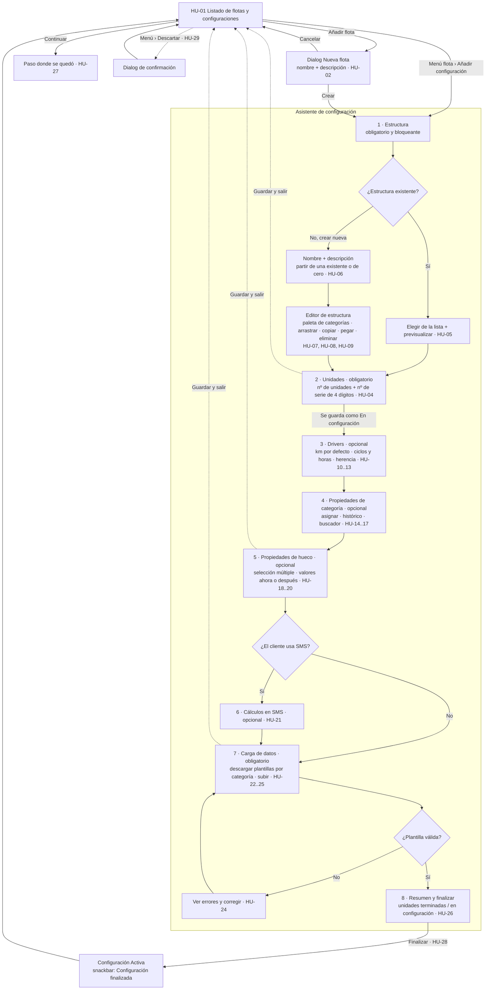

# Flujo: épica A, alta inicial de una configuración

**Estado:** borrador, pendiente de validar
**Historias:** HU-01 a HU-29 (ver `historias/backlog-configuracion.md`)

## Idea general
El alta inicial es un **asistente por pasos** (`stepper-horizontal`) que se abre desde el listado de flotas (HU-01).
- Los pasos **obligatorios** son Estructura, Unidades y Carga de datos.
- Los pasos **opcionales** (Drivers, Propiedades de categoría, Propiedades de hueco y SMS) se pueden **saltar** y completar más tarde.
- A partir del paso Unidades, la configuración **se guarda sola** con estado **En configuración**. Se puede salir y volver con **Continuar**.

## Diagrama

## Pantallas que salen del flujo
| # | Pantalla | Componentes principales |
|---|---|---|
| 0 | Listado de flotas y configuraciones | navbar, header, filtros (matSelect), tabla (matCell), tagSemantic-status, matPaginator, empty-state |
| 0b | Dialog "Nueva flota" | dialog-2, matFormField ×2 |
| 1a | Estructura: elegir existente | matRadioButton o matList, previsualización del árbol, matTabs (Existente / Nueva) |
| 1b | Estructura: editor | paleta de categorías (matList + buscador), árbol editable, matMenu (copiar, pegar, eliminar), banner informativo "solo se podrá modificar por los extremos" |
| 2 | Unidades | matFormField (nº de unidades, primer nº de serie), tabla de unidades generadas y editables |
| 3 | Drivers | árbol de la estructura con matCheckbox km / ciclos / horas por categoría |
| 4 | Propiedades de categoría | dos columnas: categorías · propiedades (matCheckbox + toggle de histórico), buscador |
| 5 | Propiedades de hueco | árbol de huecos con selección múltiple, panel de propiedades y valores |
| 6 | Cálculos en SMS | matSelect (flota o línea, driver), matRadioButton (forma de cálculo) |
| 7 | Carga de datos | tabla de plantillas por categoría (Pendiente / Cargada / Con errores), Descargar / Subir, uploader, banner de errores |
| 8 | Resumen y finalizar | matCard de resumen por paso, progreso de unidades, botón Finalizar |

Hay un elemento común a todos los pasos del asistente: el `stepper-horizontal` arriba, con un pie fijo que tiene **Anterior** (outlined), **Guardar y salir** (text) y **Siguiente / Finalizar** (filled).

## Decisiones que propone Claude (validar)
1. **Punto de guardado:** la configuración se crea, en estado En configuración, al completar el paso **Unidades**. Si sales antes, no se guarda nada y se avisa con un dialog.
2. **Pasos opcionales** con el botón "Omitir paso". En el stepper se marcan como *pendiente* y no como *hecho*.
3. **Navegación libre** hacia atrás por el stepper. Hacia delante, solo cuando los obligatorios están completos.
4. **SMS** solo aparece si el cliente lo tiene contratado.

## Preguntas para ti
1. El **nombre y la descripción**, ¿son de la **flota** o de la **configuración**? En tu tablero aparecen tanto en "crear flota" como en "crear estructura".
2. **Condición para Finalizar:** ¿todas las unidades tienen que estar terminadas? ¿O basta con cargar el **primer nivel** de la plantilla, como dice la nota roja?
3. Mientras está En configuración, ¿se puede **volver al paso Estructura y cambiarla** libremente? ¿O, una vez creadas las unidades, solo por los extremos?
4. ¿El **orden** de los pasos opcionales es el correcto: drivers → propiedades de categoría → propiedades de hueco → SMS?
