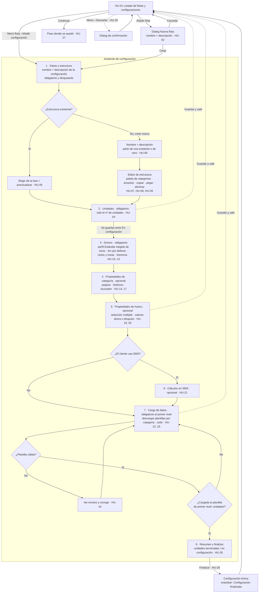

# Flujo: épica A, alta inicial de una configuración

**Estado:** validado con cambios (2026-11-03)
**Historias:** HU-01 a HU-29 (ver `historias/backlog-configuracion.md`)

## Idea general
La **flota** es el paraguas: tiene nombre y descripción. Dentro de ella hay una o varias **configuraciones**, cada una una parte de la flota con su propia estructura y su número de unidades, y con nombre y descripción propios. Por ejemplo, la flota Metro Línea 1 puede tener "Serie A", que usa Estructura 1 con 16 unidades, y "Serie B", que usa Estructura 2 con 8 unidades.

El alta inicial es un **asistente por pasos** (`stepper-horizontal`) que se abre desde el listado de flotas (HU-01).
- Los pasos **obligatorios** son Estructura, Unidades, Drivers y Carga de datos.
- Los pasos **opcionales** (Propiedades de categoría, Propiedades de hueco y SMS) se pueden **saltar** y completar más tarde.
- A partir del paso Unidades, la configuración **se guarda sola** con estado **En configuración**. Se puede salir y volver con **Continuar**.

## Diagrama

## Pantallas que salen del flujo
| # | Pantalla | Componentes principales |
|---|---|---|
| 0 | Listado de flotas y configuraciones | navbar, header, filtros (matSelect), tabla (matCell), tagSemantic-status, matPaginator, empty-state |
| 0b | Dialog "Nueva flota" (nombre y descripción de la flota) | dialog-2, matFormField ×2 |
| 1a | Datos y estructura: nombre y descripción de la configuración + elegir estructura existente | matFormField ×2, matRadioButton o matList, previsualización del árbol, matTabs (Existente / Nueva) |
| 1b | Estructura: editor | paleta de categorías (matList + buscador), árbol editable, matMenu (copiar, pegar, eliminar), banner informativo "solo se podrá modificar por los extremos" |
| 2 | Unidades | matFormField (nº de unidades). Los nº de serie llegan después en la plantilla de primer nivel |
| 3 | Drivers | estructura entera de la unidad con matCheckbox km / ciclos / horas (tiene y heredable) en cada hueco |
| 4 | Propiedades de categoría | dos columnas: categorías · propiedades (matCheckbox + toggle de histórico), buscador |
| 5 | Propiedades de hueco | árbol de huecos con selección múltiple, panel de propiedades y valores |
| 6 | Cálculos en SMS | matSelect (flota o línea, driver), matRadioButton (forma de cálculo) |
| 7 | Carga de datos | tabla de plantillas por categoría (Pendiente / Cargada / Con errores), Descargar / Subir, uploader, banner de errores |
| 8 | Resumen y finalizar | matCard de resumen por paso, progreso de unidades, botón Finalizar (activo cuando la plantilla de primer nivel está cargada) |

Hay un elemento común a todos los pasos del asistente: el `stepper-horizontal` arriba, con un pie fijo que tiene **Anterior** (outlined), **Guardar y salir** (text) y **Siguiente / Finalizar** (filled).

## Decisiones validadas
1. **Flota y configuración:** la flota es el paraguas, solo con nombre y descripción (sin código; el nombre no se puede repetir). Cada configuración es una parte de la flota con su estructura y tiene también nombre y descripción.
2. **Unidades:** en el paso 2 solo se indica cuántas. Los nº de serie y el resto de datos de la unidad (fecha, km) llegan en la **plantilla de primer nivel**.
3. **Finalizar:** se puede finalizar en cuanto está cargada la plantilla de **primer nivel (unidades)**. El resto de plantillas se puede completar después.
4. **Cambios de estructura:** solo en los **extremos** (eliminar o cambiar extremos). La construcción completa con arrastrar y soltar solo es posible mientras se crea la estructura en el paso 1.
5. **Orden de los pasos opcionales:** drivers → propiedades de categoría → propiedades de hueco → SMS.

6. **Estructuras comunes** (2026-11-03): las estructuras forman un catálogo del cliente, en el apartado **Configuración › Estructuras**. En el paso 1 del asistente solo se **elige** una existente o se **crea** una nueva, que pasa al catálogo. Una estructura en uso se modifica desde el catálogo, con aviso de impacto, y el cambio afecta a todas las configuraciones que la usan.
7. **Propiedades y SMS de la flota:** los pasos 4, 5 y 6 guardan los datos en la **flota** y avisan de que se comparten con todas sus configuraciones.

8. **Drivers comunes** (2026-11-03): los drivers se agrupan en **perfiles** del catálogo del cliente, en el apartado **Configuración › Drivers**, ligados a una estructura. En el paso 3 se elige un perfil de la estructura o se crea uno nuevo, que pasa al catálogo. Un perfil en uso se modifica desde el catálogo, con aviso de impacto.

9. **Drivers por categoría y propiedades comunes** (2026-11-03): los drivers se marcan por **categoría**. Las propiedades de categoría y de hueco pasan a **perfiles de propiedades** del catálogo del cliente (**Configuración › Propiedades**), ligados a una estructura. En el paso 4 se elige, se crea o se duplica el perfil, y los pasos 4 y 5 lo editan, avisando si lo usan otras configuraciones. La flota se queda solo con el SMS. **Opción B decidida (2026-11-04).**

10. **Misma regla para drivers y propiedades en el asistente** (2026-11-04): en los pasos 3, 4 y 5 se **elige** un perfil existente o se **crea** uno nuevo. Si el perfil lo usan **otras configuraciones**, en el asistente se ve en **solo lectura**: para cambiarlo para todas se va a su apartado (con aviso de impacto) o se **duplica** para esta configuración. Si **solo lo usa esta configuración**, se edita en el mismo asistente.

11. **Propiedades de categoría y de hueco separadas** (2026-11-04): son dos catálogos con su propio apartado lateral (**Propiedades de categoría** y **Propiedades de hueco**). El paso 4 elige o crea un perfil de propiedades de categoría y el paso 5, uno de propiedades de hueco, de forma independiente y con la misma regla que los drivers.

12. **Perfiles por defecto** (2026-11-04): cada estructura tiene un perfil «Estándar» de drivers, de propiedades de categoría y de propiedades de hueco, que se crea solo con la estructura. Aparece el primero y marcado como *Por defecto*. No se puede eliminar.

13. **Perfil existente en solo lectura; drivers obligatorio** (2026-11-04): en el asistente, un perfil existente (de drivers o de propiedades) **nunca se marca ni desmarca**: se ve en solo lectura y, para cambiarlo, se modifica en su apartado o se duplica. Solo se marca al **crear un perfil nuevo**. El paso **Drivers es obligatorio** y empieza con el perfil Estándar elegido. Los pasos de **propiedades de categoría y de hueco son opcionales**: la configuración puede quedarse **sin perfil** (opción *Sin propiedades*), y no hay nada elegido de inicio. Sustituye a la parte de la decisión 10 que permitía editar en el asistente un perfil que solo usaba esa configuración.

14. **Drivers por configuración y propiedades únicas** (2026-11-04). Sustituye a las decisiones 8 a 13:
    - **Drivers:** propios de cada configuración (flota + estructura). Se marcan en el paso 3, partiendo del kilometraje por defecto. El apartado **Drivers** del menú lista las configuraciones (flota, configuración, estructura y resumen de drivers) y permite modificar los de cada una; el cambio solo le afecta a ella.
    - **Propiedades de categoría:** un único juego del cliente. Se editan en **Configuración › Propiedades de categoría** (todas las categorías) y en el paso 4 (las de la estructura), con aviso de que afectan a todas las flotas.
    - **Propiedades de hueco:** de cada estructura. Se editan en **Configuración › Estructuras**, pestaña *Propiedades de hueco*. El paso 5 solo las muestra, con el botón *Modificar en Estructuras*. Desaparece el apartado Propiedades de hueco.

## En prueba (rama prueba/estructura-y-unidades)
- **Añadir unidad a una configuración activa** (2026-11-05): la opción *Añadir unidad* abre el asistente con todo en solo lectura menos el **nº de unidades** (paso 1, tiene que ser mayor que el actual) y la **carga de datos** (paso 5). La **plantilla de unidades** (primer nivel) vuelve a quedar pendiente y es **obligatoria**; el resto se puede subir si ya se tienen los datos. Los cambios son un borrador: solo se guardan al pulsar *Añadir N unidades* en el resumen. Si se sale antes (*Cancelar*, con aviso, o cerrando la página), no se guarda ningún cambio.
- **Consultar una configuración activa** (2026-11-05): la opción *Consultar* abre el asistente entero en solo lectura, desde el paso 1. Todos los pasos están accesibles en la barra de pasos y se recorren con *Anterior* y *Siguiente*. No se puede modificar ni guardar nada: los campos están bloqueados, no hay *Subir* plantilla (sí *Descargar*) ni *Finalizar*. Un aviso indica que es una consulta y el pie tiene *Volver al listado*.
- **Listado de flotas** (2026-11-05): sin columnas Descripción ni Últ. actualización; la descripción se ve en un icono *info* (tooltip) junto al nombre. *Continuar* e *Iniciar configuración* son botones tonales. Menú de 3 puntos de la **flota**: Añadir configuración y Modificar nombre y descripción. Menú de cada **configuración**: Modificar nombre y descripción; si está sin configurar o en configuración, Eliminar; si está activa, Consultar y Añadir unidad (fuera del alcance del prototipo).
- **Cálculo en SMS junto a los drivers** (2026-11-05): desaparece el paso *Cálculos en SMS*. En el paso 3, dentro de la sección de drivers, hay una parte opcional *Cálculo en SMS* (solo si la flota usa SMS; de momento, en el prototipo todas las flotas lo usan). Como los drivers, es de **cada configuración** (flota + estructura). También se edita en **Configuración › Drivers**. Cada cálculo tiene dos pasos: **1. Driver** (kilometraje, ciclos u horas) y **2. Forma de cálculo** (Flota, Línea, Categoría, o Categoría y posición). Con *Añadir otro driver* se añade otro cálculo (uno por driver). Un cálculo a medias impide continuar. El asistente queda en 6 pasos.
- **Drivers sobre la estructura entera de la unidad** (2026-11-04): en el paso 3 (y en Configuración › Drivers) los drivers ya no se marcan por categoría sino en cada hueco de la estructura. Al marcar un hueco, los que cuelgan de él también lo tienen y lo heredan. La plantilla de una categoría pide el valor inicial de un driver si algún hueco de esa categoría lo tiene sin heredarlo.
- **Confirmar la estructura** (2026-11-04): al pulsar *Siguiente* en el paso 1 por primera vez, un dialog avisa de que los pasos siguientes se basan en la estructura elegida y que, una vez confirmada, no se puede cambiar: si se necesita otra, hay que crear de nuevo la configuración. Botones *Revisar estructura* y *Confirmar y continuar*. Hasta confirmarla, los demás pasos no se pueden abrir desde la barra de pasos.
- **Crear una estructura nueva desde el asistente** (2026-11-04): la pestaña *Crear una estructura nueva* del paso 1 explica cómo se crea y tiene el botón *Ir a Estructuras*, que lleva a **Configuración › Estructuras** (nueva estructura). Al abrir la pestaña se quita la estructura existente que estuviera elegida. Al pulsar *Crear y volver al asistente*, la estructura entra en el catálogo, queda asignada a la configuración y se vuelve al paso 1. Desde entonces la estructura queda fijada: ya no se puede elegir una existente. *Cancelar y volver al asistente* vuelve sin estructura.
- **Estructura y propiedades de hueco unidas** (2026-11-04):
  - La estructura define **qué propiedades** tiene cada hueco (Configuración › Estructuras).
  - **Paso 1:** la estructura se ve en dos pestañas, *Estructura* y *Propiedades de hueco*, solo para consultar: al elegir la estructura ya vienen sus propiedades de hueco seleccionadas. Una estructura nueva creada en el asistente empieza sin ellas (se seleccionan en Configuración › Estructuras).
  - **Paso 2 (opcional): Valores de propiedades de hueco.** Lista de las propiedades de hueco de la estructura (propiedad, hueco y posición) con un campo para su valor. Los valores son únicos de la configuración y se pueden dejar vacíos. Ejemplo: Estructura 1 tiene el código de posición en todos los coches. Si la estructura no tiene propiedades, el paso muestra un estado vacío.
  - Desaparece el paso 5: el asistente queda en 7 pasos (6 si el cliente no usa SMS).
- **Datos básicos en la flota** (2026-11-04): al crear la flota (**Nueva flota**) o al iniciar una flota sin configuraciones se piden sus datos básicos:
  - Nombre y descripción de la flota (solo al crearla).
  - **¿Cuántas estructuras tiene?** *Una* o *Varias*.
  - **Una:** no se pide nada más. La configuración se llama como la flota.
  - **Varias:** cuántas (2 a 10) y el **nombre** de cada una (obligatorio y sin repetir). La configuración no tiene descripción.
  - **La estructura y el nº de unidades no se piden aquí**, sino en el **primer paso** de cada configuración.
  - **Una → «Crear y configurar»:** se crea la flota con su configuración y se abre el asistente en el paso 1.
  - **Varias → «Crear»:** se crean la flota y sus configuraciones (En configuración, *Sin iniciar*, estructura «Sin elegir») y **el flujo termina** en el listado, con la flota desplegada. El usuario entra en cada configuración con **«Iniciar configuración»**.
- **Pasos 1 y 2 juntos:** el asistente tiene un solo paso **Estructura y unidades**. Sirve para añadir una configuración a una flota que ya tiene otras (nombre, descripción, nº de unidades y estructura, que se puede crear aquí) y para revisar las ya creadas.

## Decisiones de Claude (siguen como propuesta)
1. **Punto de guardado:** la configuración se crea, en estado En configuración, al completar el paso **Unidades**. Si sales antes, no se guarda nada y se avisa con un dialog.
2. **Pasos opcionales**: no hay botón "Omitir paso" (decidido 2026-11-04). En los pasos opcionales basta con pulsar *Siguiente* sin rellenar nada.
3. **Navegación libre** hacia atrás por el stepper. Hacia delante, solo cuando los obligatorios están completos.
4. **SMS** solo aparece si el cliente lo tiene contratado.
