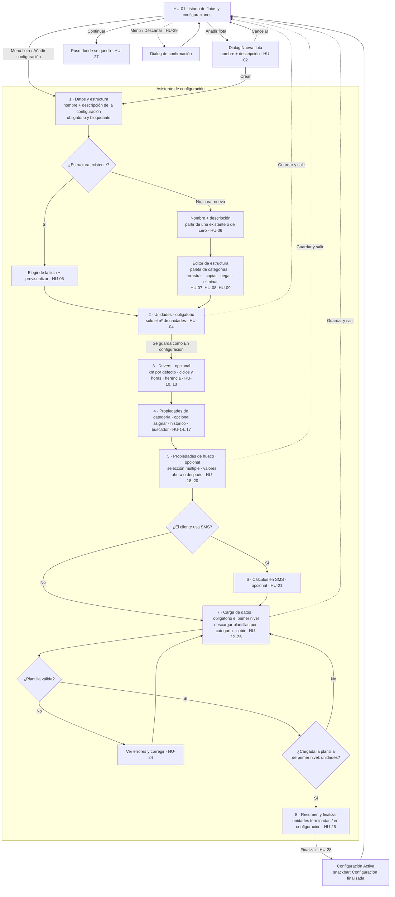

# Flujo: épica A, alta inicial de una configuración

**Estado:** validado con cambios (2026-11-03)
**Historias:** HU-01 a HU-29 (ver `historias/backlog-configuracion.md`)

## Idea general
La **flota** es el paraguas: tiene nombre y descripción. Dentro de ella hay una o varias **configuraciones**, cada una una parte de la flota con su propia estructura y su número de unidades, y con nombre y descripción propios. Por ejemplo, la flota F1000 puede tener "Serie A", que usa Estructura 1 con 16 unidades, y "Serie B", que usa Estructura 2 con 8 unidades.

El alta inicial es un **asistente por pasos** (`stepper-horizontal`) que se abre desde el listado de flotas (HU-01).
- Los pasos **obligatorios** son Estructura, Unidades y Carga de datos.
- Los pasos **opcionales** (Drivers, Propiedades de categoría, Propiedades de hueco y SMS) se pueden **saltar** y completar más tarde.
- A partir del paso Unidades, la configuración **se guarda sola** con estado **En configuración**. Se puede salir y volver con **Continuar**.

## Diagrama

## Pantallas que salen del flujo
| # | Pantalla | Componentes principales |
|---|---|---|
| 0 | Listado de flotas y configuraciones | navbar, header, filtros (matSelect), tabla (matCell), tagSemantic-status, matPaginator, empty-state |
| 0b | Dialog "Nueva flota" (nombre y descripción de la flota) | dialog-2, matFormField ×2 |
| 1a | Datos y estructura: nombre y descripción de la configuración + elegir estructura existente | matFormField ×2, matRadioButton o matList, previsualización del árbol, matTabs (Existente / Nueva) |
| 1b | Estructura: editor | paleta de categorías (matList + buscador), árbol editable, matMenu (copiar, pegar, eliminar), banner informativo "solo se podrá modificar por los extremos" |
| 2 | Unidades | matFormField (nº de unidades). Los nº de serie llegan después en la plantilla de primer nivel |
| 3 | Drivers | árbol de la estructura con matCheckbox km / ciclos / horas por categoría |
| 4 | Propiedades de categoría | dos columnas: categorías · propiedades (matCheckbox + toggle de histórico), buscador |
| 5 | Propiedades de hueco | árbol de huecos con selección múltiple, panel de propiedades y valores |
| 6 | Cálculos en SMS | matSelect (flota o línea, driver), matRadioButton (forma de cálculo) |
| 7 | Carga de datos | tabla de plantillas por categoría (Pendiente / Cargada / Con errores), Descargar / Subir, uploader, banner de errores |
| 8 | Resumen y finalizar | matCard de resumen por paso, progreso de unidades, botón Finalizar (activo cuando la plantilla de primer nivel está cargada) |

Hay un elemento común a todos los pasos del asistente: el `stepper-horizontal` arriba, con un pie fijo que tiene **Anterior** (outlined), **Guardar y salir** (text) y **Siguiente / Finalizar** (filled).

## Decisiones validadas
1. **Flota y configuración:** la flota es el paraguas, con nombre y descripción. Cada configuración es una parte de la flota con su estructura y tiene también nombre y descripción.
2. **Unidades:** en el paso 2 solo se indica cuántas. Los nº de serie y el resto de datos de la unidad (fecha, km) llegan en la **plantilla de primer nivel**.
3. **Finalizar:** se puede finalizar en cuanto está cargada la plantilla de **primer nivel (unidades)**. El resto de plantillas se puede completar después.
4. **Cambios de estructura:** solo en los **extremos** (eliminar o cambiar extremos). La construcción completa con arrastrar y soltar solo es posible mientras se crea la estructura en el paso 1.
5. **Orden de los pasos opcionales:** drivers → propiedades de categoría → propiedades de hueco → SMS.

## Decisiones de Claude (siguen como propuesta)
1. **Punto de guardado:** la configuración se crea, en estado En configuración, al completar el paso **Unidades**. Si sales antes, no se guarda nada y se avisa con un dialog.
2. **Pasos opcionales** con el botón "Omitir paso". En el stepper se marcan como *pendiente* y no como *hecho*.
3. **Navegación libre** hacia atrás por el stepper. Hacia delante, solo cuando los obligatorios están completos.
4. **SMS** solo aparece si el cliente lo tiene contratado.
